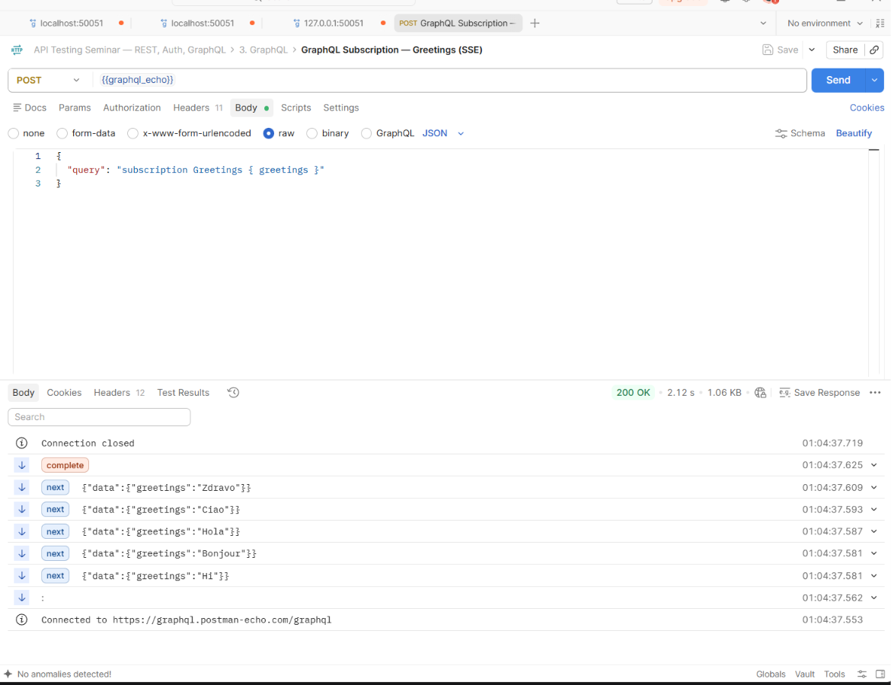

# CI/CD для API тестов
Реализовал сборку образа для запуска тестов из второй лабораторной.

## How TO запустить (локально):
Сборка образа:
```shell
docker build -t mts-labwork-3:latest .  
```
Образ содержит две переменные которые надо задать при запуске или задать в окружении заранее.
Запуск образа с передачей значений:
```shell
docker run --rm -e PLAYGROUND_USERNAME=<uname> -e PLAYGROUND_PASSWORD=<passwd> mts-labwork-3:latest
```
Запуск образа с получением переменных из запускаемой среды
```shell
docker run --rm --env PLAYGROUND_USERNAME --env PLAYGROUND_PASSWORD mts-labwork-3:latest
```

## Как это работает в пайплайне
1. Сборка образа, состоит из трех слоев:
   1.1 Копируем pom.xml
   1.2 Заранее ставим зависимости
   1.3 Копируем исходные файлы
2. Я использовал docker/setup-buildx-action@v3 для того чтобы иметь возможность кэшировать слои в пипелине и это работало почти также быстро, как локально
3. Последний степ - запуск самих тестов, тут важно, что в образе объявлена CMD которая является запускаемой командой при старте контейнера, она отработает и вернет код возврата, при успешном прохождении тестов получим 0 и джоба(или действие) зеленая.


# Автотесты REST и GraphQL API

## Требования

- JDK 21
- Maven 3.9+ в `PATH`

## Запуск из корня проекта
```powershell
mvn clean test
```
```bash
./gradlew clean test
```

## API и сценарии

- REST: `https://playground.nileslabs.com/api/v1`.
- GraphQL: `https://graphql.postman-echo.com/graphql`.
- Данные login из задания: `B***t / p********3`. Готовые токены не хранятся.

| Тест | Что проверяется |
| --- | --- |
| `PostsTest.createUpdateAndGetPost` | POST 201, извлечение id, PATCH 200, GET 200; id, новое название, сохранение body и user_id |
| `AuthTest.loginAndGetCurrentUser` | Login 200, непустой строковый access_token, явный Bearer-заголовок, профиль пользователя |
| `AuthTest.rejectRequestWithoutToken` | Без токена: HTTP 401, JSON-статус и описание ошибки авторизации |
| `GraphQlTest.queryHello` | HTTP 200, data.hello = Hello Ivan, отсутствие errors |
| `GraphQlTest.createPerson` | HTTP 200, непустой строковый id, name = Student, age = 20, отсутствие errors |
| `GraphQlTest.rejectUnknownQueryField` | Дополнительный негативный сценарий: HTTP 200, ошибка неизвестного поля в errors, отсутствие успешных data |

Задание с Postman
